# Experiment 1
- Robot can move freely throughout environment

### Folder structure
    my_robot_sim/
    │
    ├── maps/
    │   ├── map.yaml
    │   └── map.pgm          ← generated with Python
    │
    ├── worlds/
    │   └── world.sdf        ← Gazebo environment
    │
    ├── launch/
    │   └── sim.launch.py    ← starts the simulation
    │
    └── package.xml

### On system basis 
                    my_robot_sim
                         │
          ┌──────────────┼──────────────┐
          │              │              │
          ▼              ▼              ▼
      map.pgm        world.sdf     sim.launch.py
      map.yaml           │              │
          │              │              │
          │              ▼              │
          │         Gazebo Sim          │
          │              │              │
          │         TurtleBot3          │
          │              │              │
          └──────► Nav2 ◄───────────────┘
                    │
                    │ navigation
                    ▼
                  RViz2


    Python (generate_map.py)
    │
    │ generates
    ▼
    map.pgm + map.yaml
    │
    ▼
    ┌──────────────────────┐
    │        Nav2          │
    │                      │
    │  Map Server          │
    │  AMCL                 │
    │  Planner              │
    │  Controller           │
    └──────────┬───────────┘
            │
        /cmd_vel
            │
            ▼
    ┌──────────────────────┐
    │      Gazebo Sim      │
    │                      │
    │    world.sdf         │
    │         +            │
    │     TurtleBot3       │
    └──────────┬───────────┘
            │
        sensor data
        odometry / TF
            │
            └──────────────► Nav2

            │
            ▼
            RViz2


### Screenshots
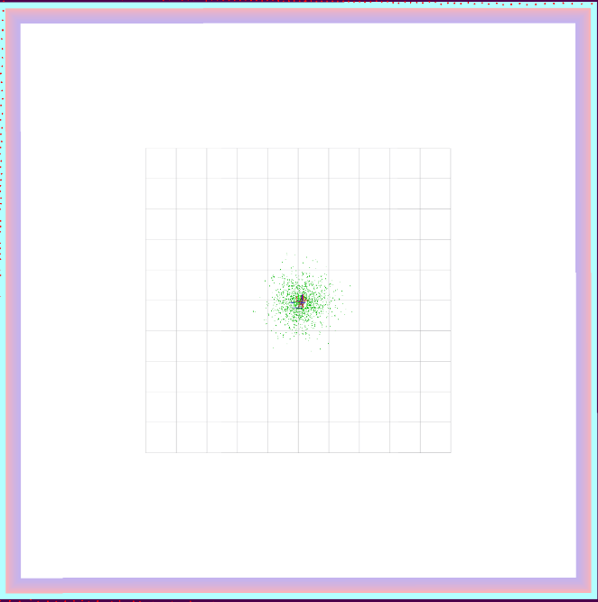
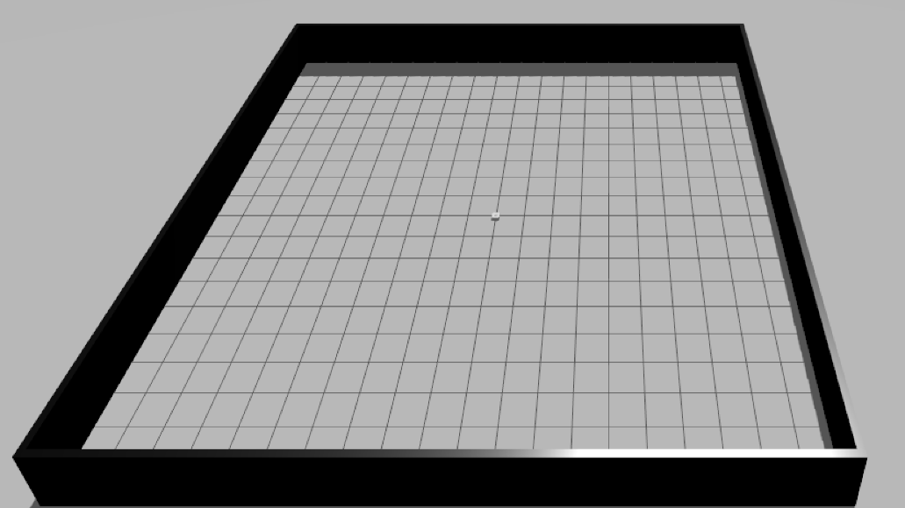
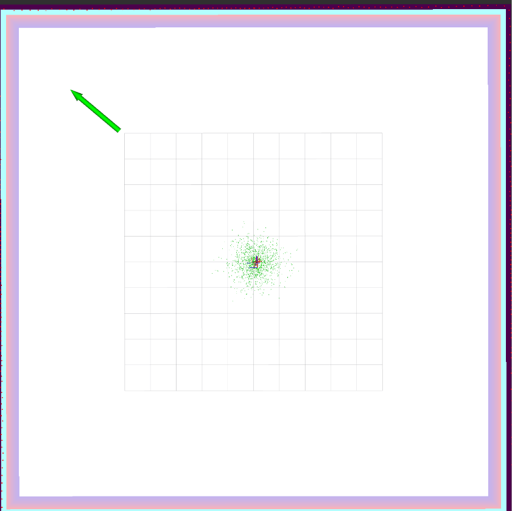
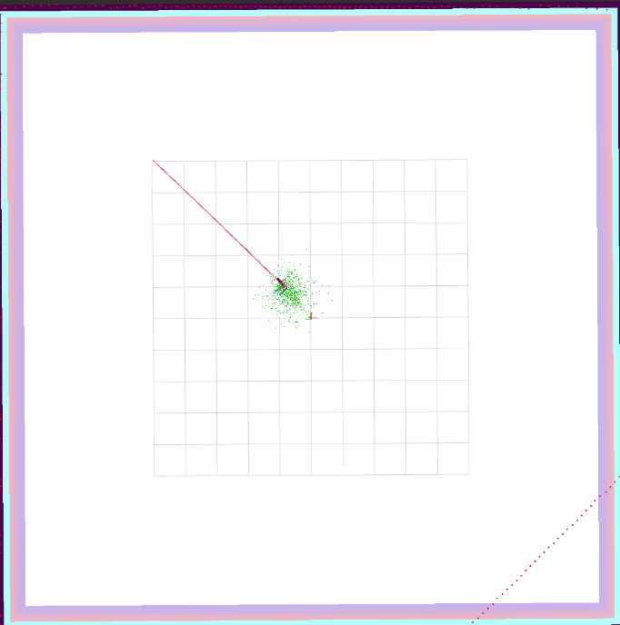
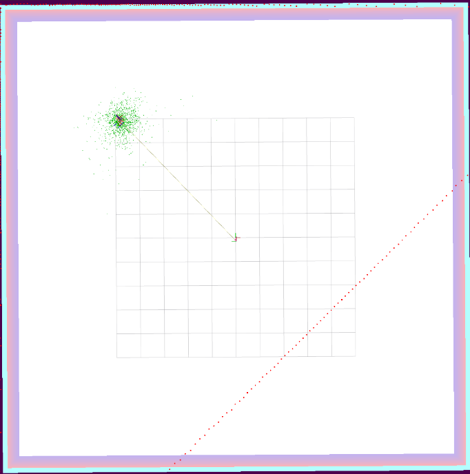
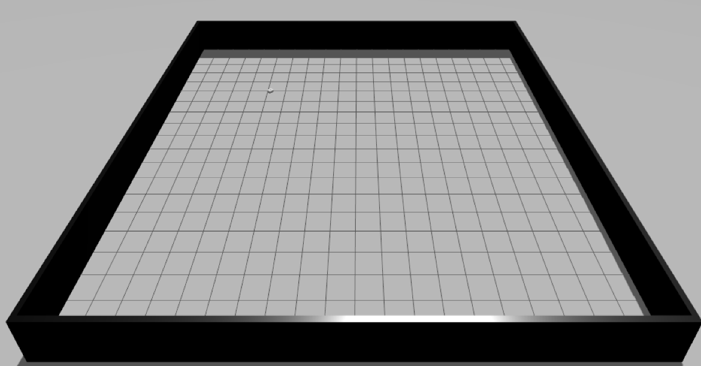

# Experiment 2
- Specific zone becomes restricted and robot is prohibited from entering it

1. Prepare filter mask   

        /home/ws/src/my_robot_sim/
        ├── config/
        │   └── nav2_params.yaml       ← customized
        ├── maps/
        │   ├── map.pgm
        │   ├── map.yaml
        │   ├── keepout_mask.pgm
        │   └── keepout_mask.yaml
        ├── launch/
        │   └── sim.launch.py
        └── worlds/
            └── world.sdf

- Like all other maps, filter maps should have its own YAML metadata

                     Experiment 2

             map.pgm
                │
                ▼
         ┌──────────────┐
         │     Nav2     │
         │              │
         │ Keepout      │◄──── keepout_mask.pgm
         │ Filter       │
         └──────┬───────┘
                │
             valid path
                │
                ▼
             Robot
                │
                ▼
             Gazebo


### Map
            ROS map coordinates

                y = +10 m
        ┌────────────────────┐
        │████████████████████│
        │████   ZONE B  █████│
        │████  RESTRICTED ███│
        │████████████████████│
        │────────────────────│ ← y = +3 m
        │                    │
        │      ZONE A        │
        │    unrestricted    │
        │                    │
        │                    │
        └────────────────────┘
                y = -10 m

    - Lightness = 0 (dark/black)   --> occupied / restricted
    - Lightness = 255 (white)      --> free / unrestricted
    (PGM values run 0–255, not 0–100 — this exact mix-up caused Bug 2, see below)

### Nav2 with 2 zones --> nav2_params.yaml in different folder
Your launch file
      ↓
/home/ws/src/my_robot_sim/config/nav2_params.yaml
      ↓
your customized Nav2

Old one is here: /opt/ros/jazzy/share/nav2_bringup/params/nav2_params.yaml

                    Nav2
                    │
        ┌──────────┴──────────┐
        │                     │
    Global Costmap         Local Costmap
        │                     │
    Keepout Filter         Keepout Filter
        │                     │
        ▼                     ▼
    "Don't plan here"     "Don't drive here"
Nav2 specifically recommends using the filter on both when you want the robot both to plan around and avoid entering keepout zones.

⚠ We deviated from this recommendation — see Bug 1 below. Local costmap does
NOT get the keepout filter in the final setup; only global costmap does.

2. Configure costmap filter info publisher server

                     Experiment 2
                          │
            ┌─────────────┴─────────────┐
            │                           │
       Normal map                  Keepout mask
        map.pgm                  keepout_mask.pgm
            │                           │
            │                           ▼
            │                CostmapFilterInfoServer
            │                           │
            └──────────────┬────────────┘
                           ▼
                    Nav2 Costmap
                           │
                     Keepout Filter
                           │
                    ┌──────┴──────┐
                    │             │
                 Zone A         Zone B
              unrestricted     restricted
                    │             │
                    └──────┬──────┘
                           ▼
                       Planner
                           │
                           ▼
                       TurtleBot3

nav2_map_server --> /opt/ros/jazzy  
nav2_costmap_2d --> /opt/ros/jazzy

CostmapFilterInfoServer is configured directly in sim.launch.py (not in
nav2_params.yaml):

```
costmap_filter_info_server = Node(
    package='nav2_map_server',
    executable='costmap_filter_info_server',
    parameters=[{
        'type': 0,
        'filter_info_topic': '/costmap_filter_info',
        'mask_topic': '/filter_mask',
        'base': 0.0,
        'multiplier': 1.0,
    }],
)
```
Both topic names must be absolute (leading `/`) — see Bugs 3 & 4 below.

- Modifying global and local costmap in nav2_params.yaml  
/home/ws/src/my_robot_sim/config/nav2_params.yaml

#### Modify global costmap: plan around restricted zone B  

Add a filters entry:

``` filters: ["keepout_filter"] ```

and add the filter configuration:

``` keepout_filter:
  plugin: "nav2_costmap_2d::KeepoutFilter"
  enabled: True
  filter_info_topic: "/costmap_filter_info"
```
(leading `/` required — see Bug 3 below)

#### Local costmap: deliberately NOT modified

Originally we followed the Nav2 recommendation above and added the same
`keepout_filter` block to `local_costmap` too, pointed at a second topic
(`keepout_costmap_filter_info`). We removed it — two reasons:

1. Only one `costmap_filter_info_server` is launched, publishing on
   `costmap_filter_info`. The local filter's topic name never matched a real
   publisher, so it was silently doing nothing anyway (Bug 1).
2. `local_costmap.global_frame` is `odom` (rolling window), but the keepout
   mask is defined in the `map` frame. Masking there depends on the live
   `map → odom` transform being accurate — any localization drift shows up
   as misalignment right at the robot. `global_costmap` doesn't have this
   problem since it's already in the `map` frame.

Global costmap's lethal cost already blocks the global planner from routing
into the zone, which is enough for "robot should not plan a route there."
Local reactive obstacle avoidance (voxel + inflation layer) is untouched.

(old vs. new params path already shown above under "Nav2 with 2 zones")

### Experiment 2 — current build, after all fixes

                keepout_mask.pgm/yaml
                        │
                        ▼
            ┌───────────────────────┐        lifecycle_manager_keepout
            │  keepout_mask_server  │◄────── (autostart: configure + activate)
            │  (nav2_map_server)    │
            └───────────┬───────────┘
                        │ remap: /map → /filter_mask
                        ▼
                  /filter_mask   (OccupancyGrid, transient_local)
                        │
                        ▼
            ┌─────────────────────────────┐
            │ costmap_filter_info_server  │
            │  mask_topic: /filter_mask   │ ← absolute (Bug 4)
            └───────────┬─────────────────┘
                        ▼
                /costmap_filter_info   (CostmapFilterInfo msg)
                        │
                        ▼
        ┌───────────────────────────────────────┐
        │     global_costmap (namespace-scoped)  │
        │  filter_info_topic: /costmap_filter_info│ ← absolute (Bug 3)
        │                                          │
        │  plugins: static_layer, obstacle_layer, │
        │           inflation_layer               │
        │  filters: keepout_filter                │
        └───────────────────┬─────────────────────┘
                            │ lethal cost (100) over y ≥ 3
                            ▼
                      Global Planner
                            │
                            ▼
                    path avoids Zone B
                            │
                            ▼
                        Controller ──► TurtleBot3 ──► Gazebo

        local_costmap: voxel_layer + inflation_layer only.
                        NO keepout_filter (removed — Bug 1).
                        Reactive/local avoidance is unaffected by the
                        zone; only the GLOBAL PLAN avoids it.

Note: none of this fences the robot in physically — Gazebo has no wall or
obstacle there. It only affects what paths Nav2 will plan. Manual teleop
into the zone is not blocked.

### Bugs Encountered & Fixes

Five issues surfaced while building this. Each one hid the next — the setup
only looked broken as "robot ignores the zone entirely," but the causes were
spread across the mask file, nav2_params.yaml, and sim.launch.py.

**Bug 1 — local costmap's keepout filter was dead, and shouldn't exist anyway**
`local_costmap` pointed at `filter_info_topic: "keepout_costmap_filter_info"`,
but only one `costmap_filter_info_server` is launched (publishing on
`costmap_filter_info`, no `keepout_` prefix) — so it was listening to nothing.
Beyond that, KeepoutFilter on the local costmap is risky by design: its
`global_frame` is `odom` (rolling window) while the mask is in the `map`
frame, so masking accuracy depends on live localization drift, right at the
robot. Fixed by removing the filter from `local_costmap` entirely.

**Bug 2 — keepout mask polarity was inverted**
`keepout_mask.yaml` uses `negate: 0`, same as `map.yaml`: pixel `255` (white)
= free, pixel `0` (black) = occupied. The mask-generation script had the
fill values backwards — background `0`, restricted-zone rectangle `255` —
so y ≥ 3 (meant to be restricted) was marked free and y < 3 was marked
restricted. Fixed by swapping the two fill values in the script.

**Bug 3 — `filter_info_topic` resolved to the wrong namespace**
`global_costmap` runs inside its own `/global_costmap` ROS2 namespace. A
relative topic name (`"costmap_filter_info"`) gets prefixed with that
namespace, so the filter subscribed to `/global_costmap/costmap_filter_info`
— nothing publishes there. Symptom: `KeepoutFilter: Filter mask was not
received`, repeating forever. Fixed by making it absolute:
`"/costmap_filter_info"`.

**Bug 4 — same bug, one layer deeper: `mask_topic`**
`costmap_filter_info_server`'s `mask_topic` param (`'filter_mask'`, relative)
gets embedded inside the `CostmapFilterInfo` message it publishes, as
`filter_mask_topic`. `KeepoutFilter` subscribes to *that* value — again
relative to its own namespace, landing on `/global_costmap/filter_mask`
instead of the real `/filter_mask`. Fixed by making both launch-file topic
params absolute (`/costmap_filter_info`, `/filter_mask`).

After both namespace fixes, the log shows the correct handshake instead of
endless warnings:
```
KeepoutFilter: Received filter info from /costmap_filter_info topic.
KeepoutFilter: Received filter mask from /filter_mask topic.
```

**Bug 5 (setup gotcha, not a config bug) — AMCL needs a manual initial pose**
Without "2D Pose Estimate" in RViz after each launch, AMCL never publishes
`map → odom`, so `global_costmap` (and `bt_navigator`/`planner_server`) get
stuck `inactive`/`activating` forever — looks identical to "keepout isn't
working" but is unrelated. Workaround: set the initial pose manually each
launch. Permanent fix (hardcoding `set_initial_pose` in `amcl` params) was
identified but not yet applied.

**Verification method:** rather than trusting RViz rendering alone, each fix
was confirmed by reading `/global_costmap/costmap` `OccupancyGrid` data
directly and checking cost on both sides of the y=3 boundary:

| Point (x, y) | Expected | Result after all fixes |
|---|---|---|
| (0, 3.5) — inside restricted | lethal (100) | 100 |
| (0, 5.0) — well inside restricted | lethal (100) | 100 |
| (0, 2.5) — outside restricted | free (0) | 0 |
| (0, -5.0) — well outside restricted | free (0) | 0 |

After clicking 2D-pose estimate, map with restricted zone at y >= 3 appears
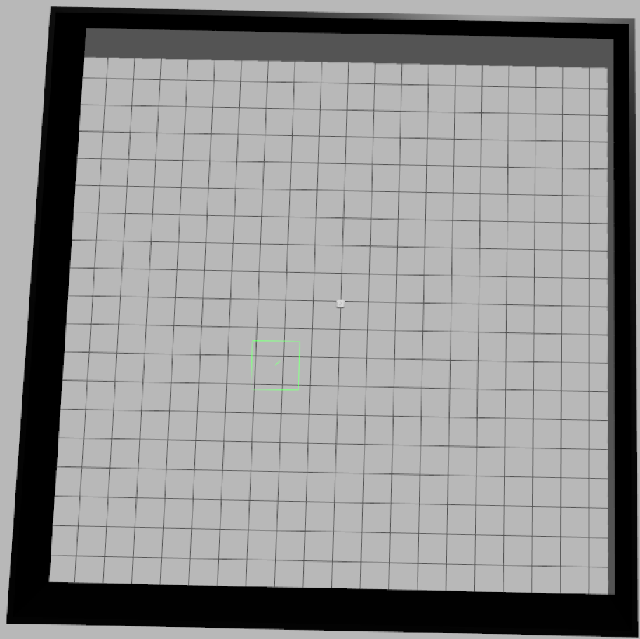
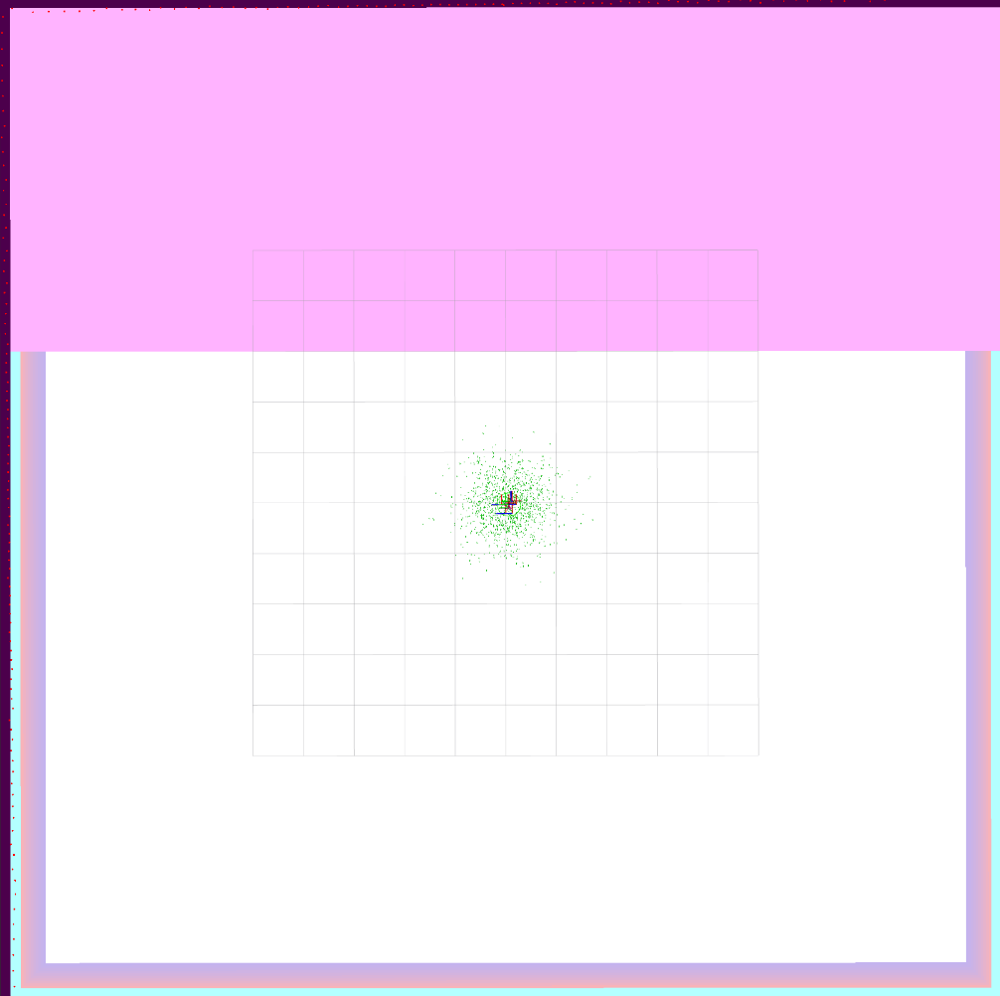

Robot navigates normally within unrestricted zone
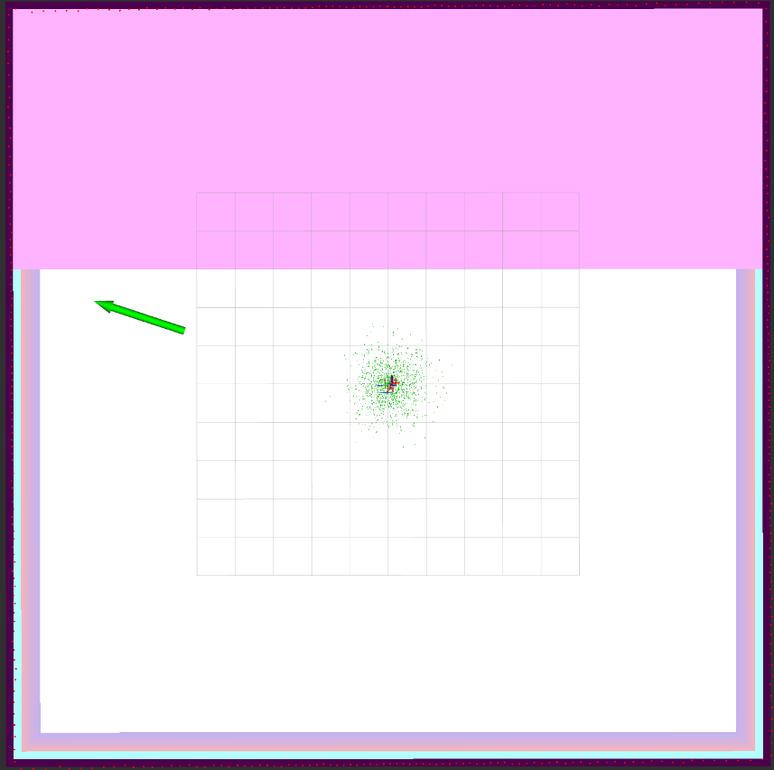
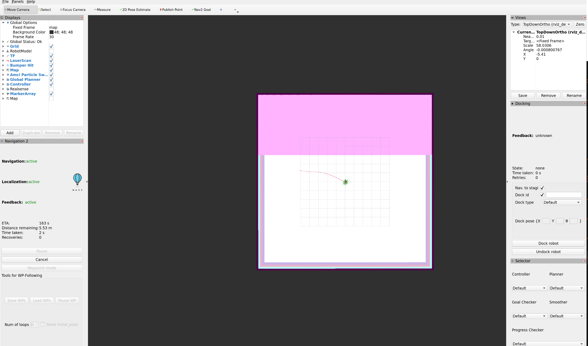
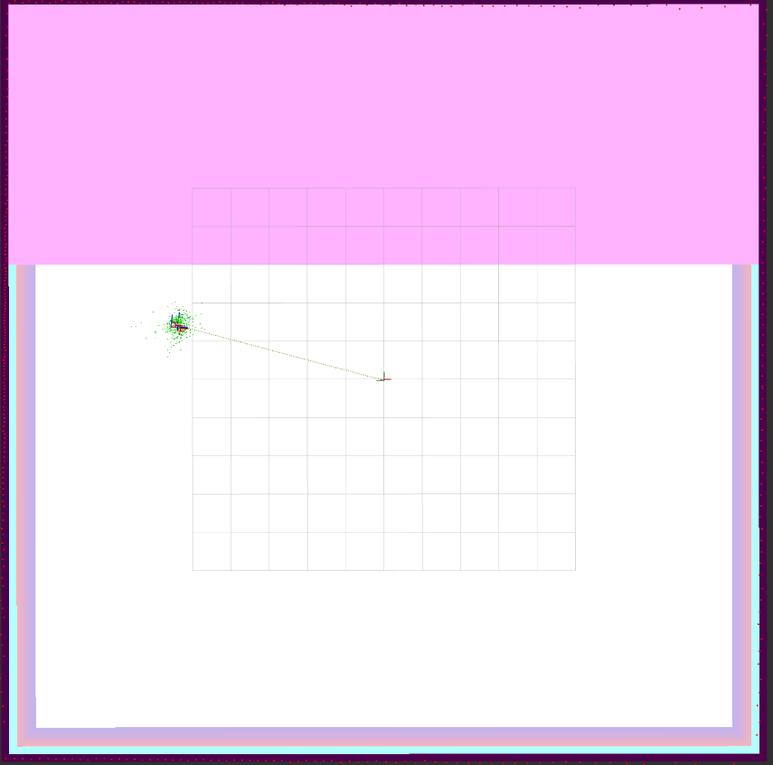
**screenrecording**

Setting new nav2 goal in **restricted zone**

# Experiment 3
