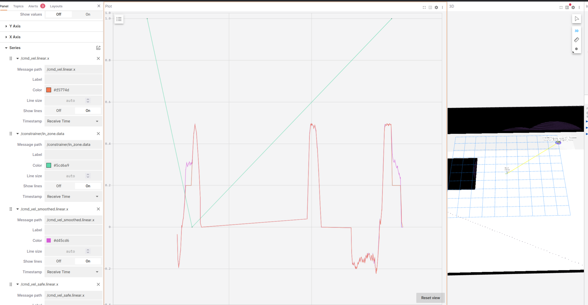

# Lichtblick
Lichtblick is an open-source visualization and debugging tool for robotics data, basically the community continuation of Foxglove Studio. It began as a fork of Foxglove Studio, an open-source project developed by Foxglove. 

It plays back recorded data such as ROS 1/ROS 2 bags and MCAP files, or connects to live systems through rosbridge or the Foxglove WebSocket protocol.
It has panels for 3D scenes (point clouds, TF frames, markers), images, time-series plots, raw messages, maps, diagnostics, and logs.
You can save and share layouts, and you can write custom extensions.

For more information: https://github.com/lichtblick-suite/lichtblick/blob/develop/README.md

You can try it directly in the browser without installing anything, or run it via Docker: docker run --rm -p 8080:8080 ghcr.io/lichtblick-suite/lichtblick:latest 
github
It’s licensed under MPL 2.0, and it’s built primarily in TypeScript and React. 
gitee
gitee
Other projects are now forking Lichtblick itself. For example, Flora is another robotics visualization tool based on the Lichtblick open-source code.

#### Map 

#### Graph tracking robot behavior

- Robot in speed zone and navigates to destination outside of speed zone
- Robot outside speed zone and navigates to destination outside of speed zone
- Robot outside of speed zone and navigates to destination within speed zone